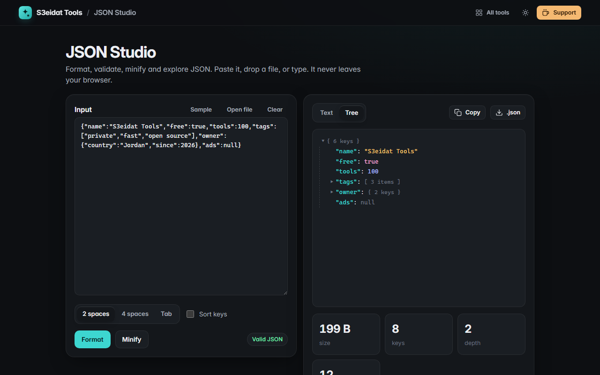

# JSON Studio

> Format, validate, minify and explore JSON. Free, private, and it runs entirely in your browser.

### ▶ [Open JSON Studio](https://s3eidat.github.io/json-studio/)



## Features

- **Format** with 2 spaces, 4 spaces or tabs, and optionally **sort keys** (deep)
- **Minify** in one click
- **Validate** with the exact **line and column** of the error, shown in context
- **Tree view** with collapsible nodes; click any key to copy its path (`$.owner.country`)
- Stats: size, keys, depth, values
- Open or drop a `.json` file, copy, or download the result

## Privacy

Your JSON never leaves your device. There is no server, no account, no analytics.
The page ships with a strict Content-Security-Policy (`connect-src 'self'`), so the browser
itself blocks any attempt to send data anywhere.

## Run it yourself

It's plain HTML, CSS and JavaScript with no build step:

```bash
git clone https://github.com/s3eidat/json-studio
cd json-studio
python -m http.server 8000
```

Then open http://localhost:8000.

## Support

If this saved you time, **[buy me a coffee ☕](https://s3eidat.github.io/coffee/)**. It keeps every tool free.

---

Part of **[S3eidat Tools](https://s3eidat.github.io/)**: 100+ free, private tools that run in your browser. MIT licensed.
